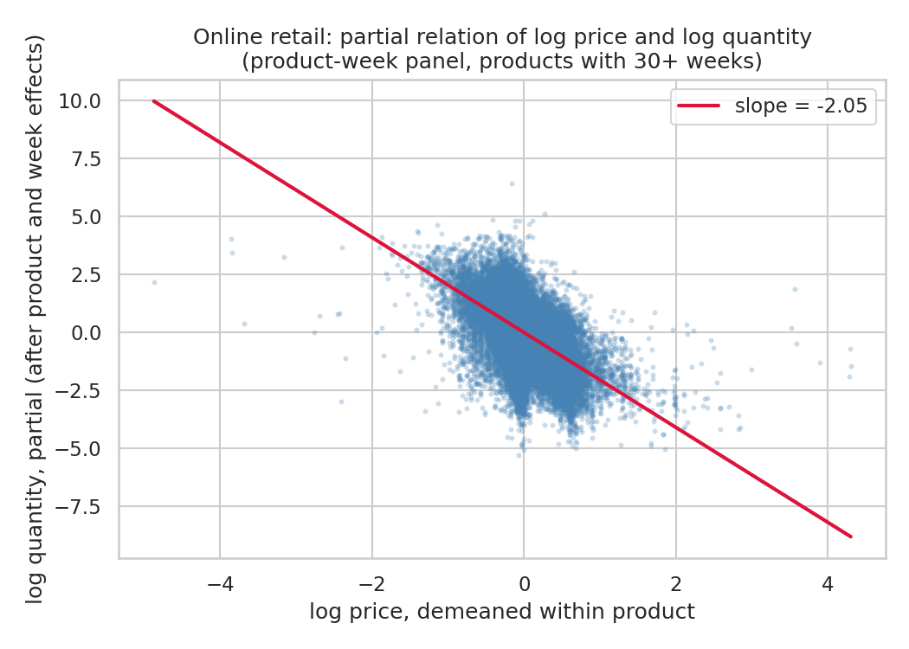
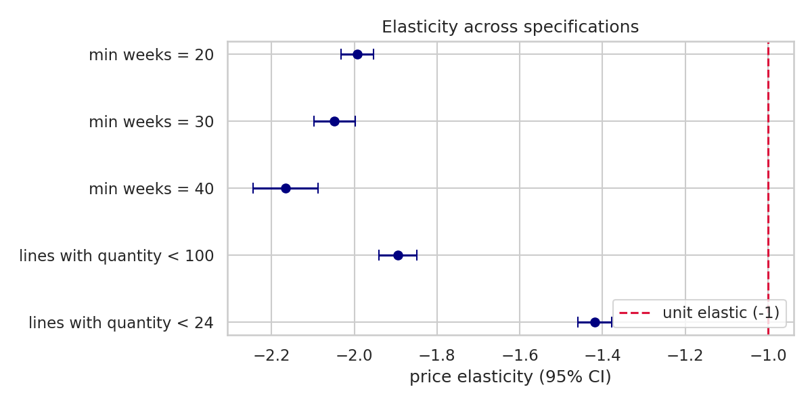
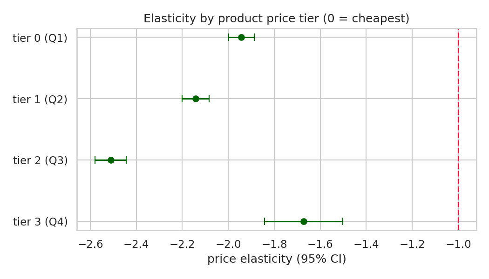

# Dynamic Pricing: Price Elasticity of Online Retail Demand

**Question.** How responsive is weekly demand to the average price paid for a product, and how certain are we about it?

**Decision supported.** Whether a price increase on a typical product is likely to reduce revenue. The estimate is conditional on the sample described below.

**Dataset.** Online retail transactions (UK gift retailer, Dec 2010 to Dec 2011). Kaggle slug `thedevastator/online-retail-transaction-data`. License listed as "other". See [data/README.md](data/README.md).

## Method

Product-week panel for products sold in at least 30 weeks (1,639 products, 71,960 product-weeks). Price is revenue divided by units each week.

Log-log model with product fixed effects (within-product demeaning) and week effects, HC3 standard errors.

$$\log q_{it} = \alpha_i + \varepsilon \log p_{it} + \gamma_t + u_{it}$$

## Result

**Within-product elasticity ε = −2.05, 95% CI [−2.10, −2.00].** The interval excludes −1, so demand is elastic in this sample.

The pooled estimate without product effects is −0.59 [−0.60, −0.58]. It is biased toward zero because cheap, high-volume products and expensive, low-volume products are compared directly.



## Sensitivity

The magnitude depends on the sample. The sign and the conclusion (elastic) hold in every specification.



| Specification | ε | 95% CI |
|---|---|---|
| Min 20 weeks | −1.99 | [−2.03, −1.95] |
| Min 30 weeks (main) | −2.05 | [−2.10, −2.00] |
| Min 40 weeks | −2.17 | [−2.24, −2.09] |
| Lines with quantity < 100 | −1.89 | [−1.94, −1.85] |
| Lines with quantity < 24 | −1.42 | [−1.46, −1.38] |

Lines with 100+ units are about 1% of lines but about 21% of revenue. Wholesale buyers often pay lower unit prices, which can make the slope more negative for reasons unrelated to consumer response. Restricting to retail-sized lines lowers the estimate to about −1.4.

## Elasticity by price tier

Tiers are quartiles of each product's mean log price. Each tier has more than 400 products.



Elasticity is most negative in the third tier (≈ −2.5) and least negative in the most expensive quartile (≈ −1.7).

## Limitation

Prices are set by the retailer and respond to demand. Promotions also coincide with demand spikes. The estimate is an association, not a causal price effect. Week effects remove common seasonality but not product-specific promotions.

## Reproduce

```bash
python -m venv .venv && source .venv/bin/activate
pip install -e ".[dev]"
bash scripts/download_data.sh          # needs KAGGLE_API_TOKEN in the environment
pytest
cd notebooks && jupyter nbconvert --to notebook --execute --inplace elasticity_analysis.ipynb
```

Notebook: [notebooks/elasticity_analysis.ipynb](notebooks/elasticity_analysis.ipynb) (source in `elasticity_analysis.py`).

## Structure

```text
src/dp_elasticity/   data cleaning, panel, and estimators
tests/               estimator recovery on simulated panel, loader and panel checks
notebooks/           analysis notebook (jupytext .py and executed .ipynb)
reports/figures/     exported figures
data/README.md       dataset provenance; raw data not committed
```
